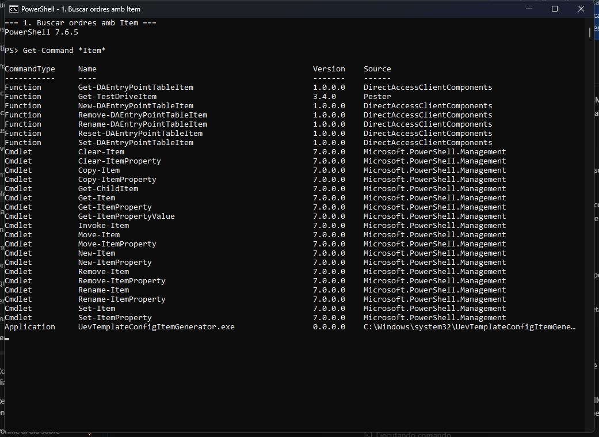
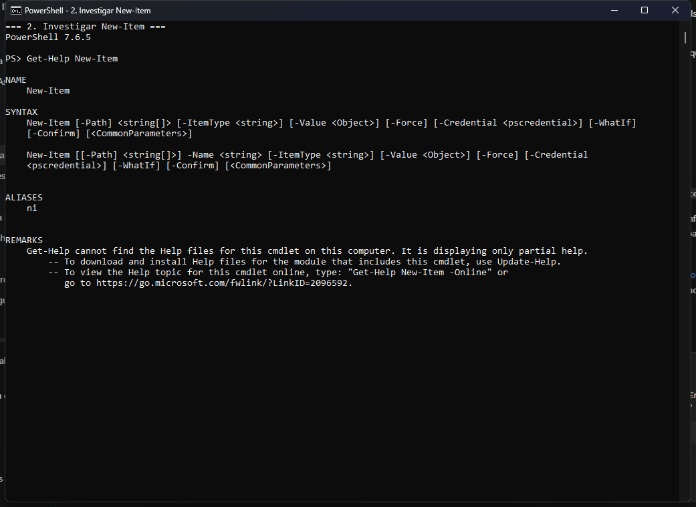
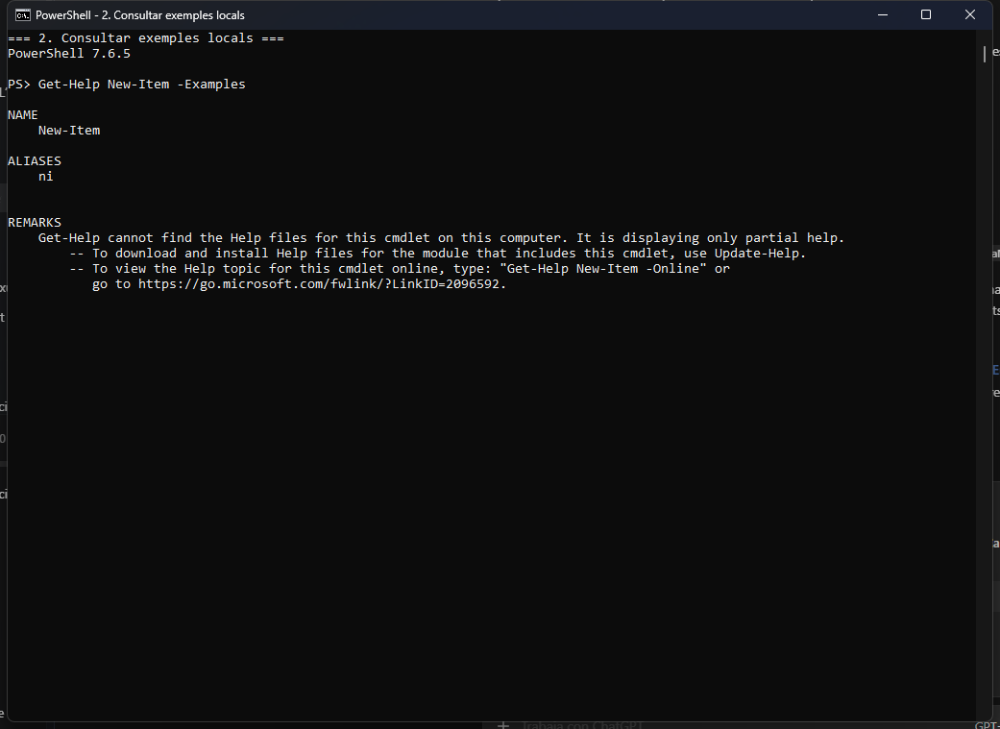
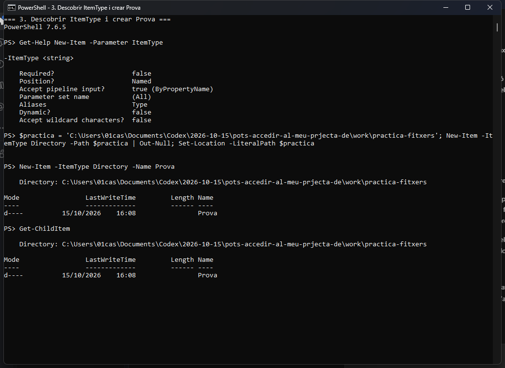
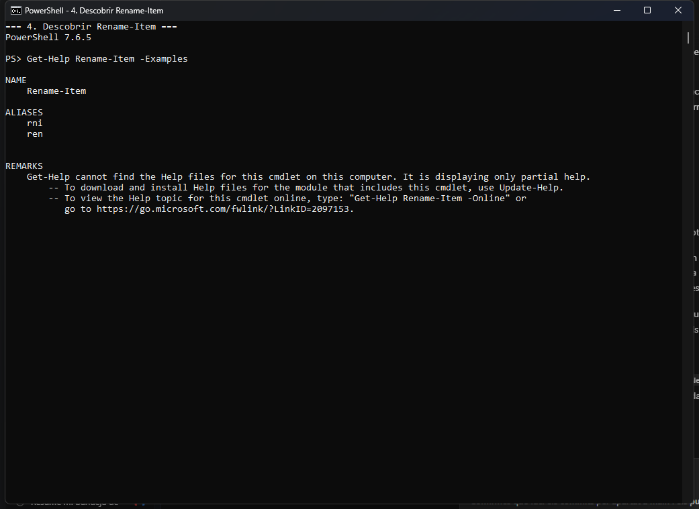
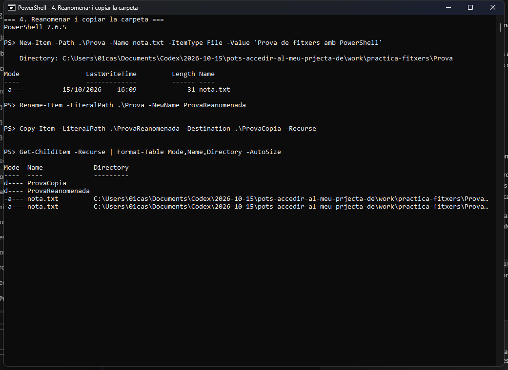
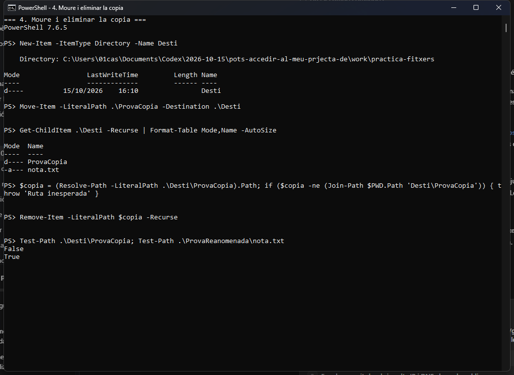
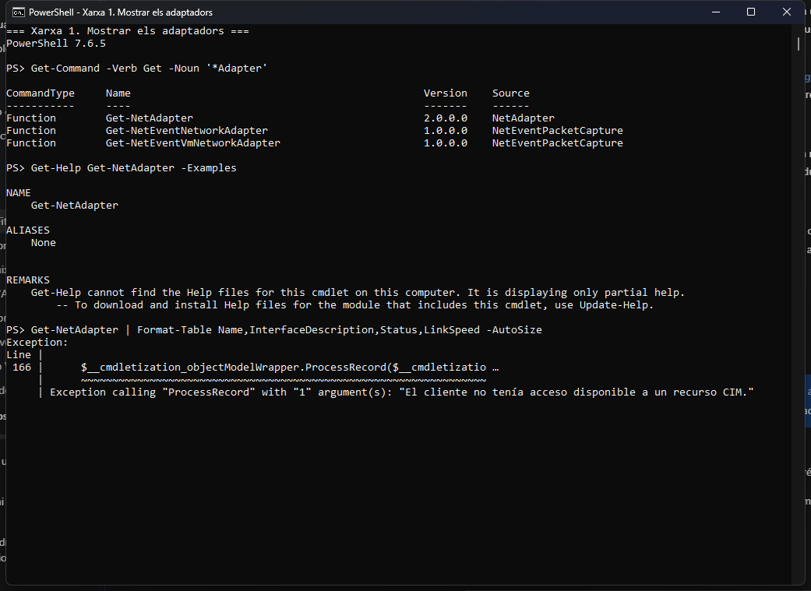

> **Nota:** aquests exercicis serveixen per familiaritzar-se amb PowerShell. He documentat les ordres, les proves i els resultats obtinguts.

# Treballar amb fitxers i carpetes

**Situació:** descobrir les ordres per treballar amb fitxers i carpetes utilitzant `Get-Command` i `Get-Help`, sense buscar respostes a Internet.

He fet les proves amb PowerShell 7.6.5 sobre Windows. Les captures són de les execucions reals i utilitzen rutes relatives a aquesta fitxa.

## 1. Buscar ordres

He buscat les ordres que contenen la paraula `Item`:

```powershell
Get-Command *Item*
```

El comodí `*` permet trobar noms amb qualsevol text abans o després d'`Item`. El resultat mostra el nom, el tipus d'ordre, la versió i el mòdul d'origen.



Entre els resultats he identificat aquestes ordres:

| Acció | Cmdlet trobat |
|---|---|
| Crear un element | `New-Item` |
| Eliminar un element | `Remove-Item` |
| Canviar el nom d'un element | `Rename-Item` |
| Copiar un element | `Copy-Item` |
| Moure un element | `Move-Item` |

També hi apareixen `Get-Item` i `Get-ChildItem`, que permeten consultar un element i llistar el contingut d'una carpeta. Encara no he executat cap ordre que modifiqui fitxers.

---

## 2. Investigar una ordre

Abans de crear cap element, he consultat:

```powershell
Get-Help New-Item
```



### Per a què serveix New-Item?

Serveix per crear un element nou. En el sistema de fitxers pot crear un fitxer o una carpeta; els tipus disponibles depenen del proveïdor on es treballa.

### Quina estructura té?

Una de les formes que mostra l'ajuda és:

```powershell
New-Item -Path <ubicació> -Name <nom> -ItemType <tipus>
```

Els textos entre `< >` són marcadors que cal substituir per valors reals.

| Paràmetre | Funció |
|---|---|
| `-Path` | Indica la ubicació on es crearà l'element. |
| `-Name` | Indica el nom del nou element. |
| `-ItemType` | Indica si volem un fitxer, una carpeta o un altre tipus admès. |

### Consulta d'exemples

```powershell
Get-Help New-Item -Examples
```



**Resultat real:** aquest equip no té instal·lats els fitxers d'ajuda complets. La primera consulta mostra la sintaxi, però `-Examples` no proporciona exemples. No he utilitzat `-Online` ni `Update-Help`, perquè l'activitat demana investigar sense Internet. Les proves dels apartats següents permeten comprovar el funcionament.

---

## 3. Descobrir un paràmetre

He consultat el paràmetre `-ItemType`:

```powershell
Get-Help New-Item -Parameter ItemType
```

La informació local indica que accepta un text (`string`), que es passa pel nom del paràmetre i que també té l'àlies `Type`. Com que l'ajuda és parcial, no enumera els valors disponibles. He provat `Directory`, el valor suggerit a l'enunciat, per comprovar que crea una carpeta.

He preparat una carpeta de pràctica anomenada `practica-fitxers` dins de l'espai de treball temporal i m'hi he situat amb `Set-Location -LiteralPath $practica`. Des d'allà he executat:

```powershell
New-Item -ItemType Directory -Name Prova
Get-ChildItem
```



**Resultat:** s'ha creat `Prova`. El llistat la mostra amb el mode `d----`, que indica que és un directori. Si no indico `-Path`, la carpeta es crea a la ubicació actual de PowerShell.

---

## 4. Nou repte: reanomenar, copiar, moure i eliminar

### 4.1. Descobrir l'ordre per canviar el nom

He revisat els resultats de `Get-Command *Item*` de l'apartat 1 i hi he trobat `Rename-Item`. Després he consultat:

```powershell
Get-Help Rename-Item -Examples
```



L'ajuda local tampoc no inclou els exemples d'aquesta ordre. He consultat també `Get-Help Rename-Item`, que mostra la sintaxi amb `-LiteralPath` i `-NewName`.

Per preparar la resta de proves he utilitzat únicament les eines d'investigació demanades:

```powershell
Get-Help Copy-Item
Get-Help Copy-Item -Parameter Recurse
Get-Help Move-Item
Get-Help Remove-Item
```

La sintaxi mostra els paràmetres de ruta, destinació i recursivitat. He comprovat el seu efecte amb les proves següents, sense buscar respostes a Internet.

### 4.2. Crear una carpeta i un fitxer de prova

La carpeta `Prova` ja s'ha creat a l'apartat 3 amb:

```powershell
New-Item -ItemType Directory -Name Prova
```

Hi he afegit un fitxer per comprovar que la còpia inclou el contingut:

```powershell
New-Item -Path .\Prova -Name nota.txt -ItemType File -Value 'Prova de fitxers amb PowerShell'
```

**Resultat:** s'ha creat `nota.txt`, de 31 bytes, dins de `Prova`.

### 4.3. Canviar-li el nom

```powershell
Rename-Item -LiteralPath .\Prova -NewName ProvaReanomenada
```

**Resultat:** la carpeta passa a dir-se `ProvaReanomenada` i conserva `nota.txt`. Amb `-NewName` indico el nou nom, sense canviar-la d'ubicació.

### 4.4. Copiar-la

```powershell
Copy-Item -LiteralPath .\ProvaReanomenada -Destination .\ProvaCopia -Recurse
Get-ChildItem -Recurse | Format-Table Mode,Name,Directory -AutoSize
```

**Resultat:** hi ha dues carpetes, `ProvaReanomenada` i `ProvaCopia`, cadascuna amb `nota.txt`. `-Recurse` copia també el contingut de la carpeta.



### 4.5. Moure-la

```powershell
New-Item -ItemType Directory -Name Desti
Move-Item -LiteralPath .\ProvaCopia -Destination .\Desti
Get-ChildItem .\Desti -Recurse | Format-Table Mode,Name -AutoSize
```

**Resultat:** `ProvaCopia` ara és dins de `Desti` i conserva el fitxer. A diferència de copiar, moure canvia la ubicació de l'element original.

### 4.6. Eliminar-la i comprovar el resultat

Abans d'eliminar res he resolt la ruta absoluta i he comprovat que correspon exactament a la còpia dins de la carpeta de pràctica:

```powershell
$copia = (Resolve-Path -LiteralPath .\Desti\ProvaCopia).Path
if ($copia -ne (Join-Path $PWD.Path 'Desti\ProvaCopia')) {
    throw 'Ruta inesperada'
}
Remove-Item -LiteralPath $copia -Recurse

Test-Path .\Desti\ProvaCopia
Test-Path .\ProvaReanomenada\nota.txt
```

**Resultat:** la primera comprovació retorna `False` perquè la còpia s'ha eliminat, i la segona retorna `True` perquè el fitxer de la carpeta original es conserva. `-Recurse` permet eliminar la carpeta amb el seu contingut.



### 4.7. Ordres descobertes

| Acció | Cmdlet | Paràmetres utilitzats |
|---|---|---|
| Crear una carpeta | `New-Item` | `-ItemType Directory -Name` |
| Canviar-li el nom | `Rename-Item` | `-LiteralPath -NewName` |
| Copiar-la amb el contingut | `Copy-Item` | `-LiteralPath -Destination -Recurse` |
| Moure-la | `Move-Item` | `-LiteralPath -Destination` |
| Eliminar-la amb el contingut | `Remove-Item` | `-LiteralPath -Recurse` |

`Get-Command` i `Get-Help` han servit per investigar. `Get-ChildItem` i `Test-Path` han servit per verificar les proves.

---

# Descobrir ordres de xarxa amb PowerShell

**Situació:** descobrir com consultar la configuració de xarxa d'un equip Windows.

Per a cada tasca documento el cmdlet, la cerca amb `Get-Command`, la consulta amb `Get-Help`, què fa, l'ordre executada i el resultat real. No he consultat Internet per resoldre els exercicis.


## 1. Mostrar els adaptadors de xarxa

**Cmdlet trobat:** `Get-NetAdapter`. Serveix per consultar els adaptadors de xarxa i dades com el nom, la descripció, l'estat i la velocitat d'enllaç.

### Com l'he localitzat

```powershell
Get-Command -Verb Get -Noun '*Adapter'
Get-Help Get-NetAdapter
Get-Help Get-NetAdapter -Examples
```

La cerca ha retornat `Get-NetAdapter`, del mòdul `NetAdapter`, entre altres ordres. Tot i que `Get-Command` el classifica com a `Function` perquè és una ordre generada sobre CIM, és l'ordre de PowerShell adequada per a aquesta tasca. L'ajuda local mostra la sintaxi, però no inclou exemples complets.

### Ordre executada i resultat

```powershell
Get-NetAdapter | Format-Table Name,InterfaceDescription,Status,LinkSpeed -AutoSize
```



**Resultat real:** l'ordre s'ha intentat executar, però la sessió retorna una excepció de CIM:

```text
Exception calling "ProcessRecord" with "1" argument(s):
"El cliente no tenía acceso disponible a un recurso CIM."
```

Per tant, no he obtingut el llistat d'adaptadors. He descobert l'ordre, però aquesta comprovació queda limitada pels permisos de l'entorn d'execució; no és un resultat que indiqui que l'equip no tingui adaptadors.

---


