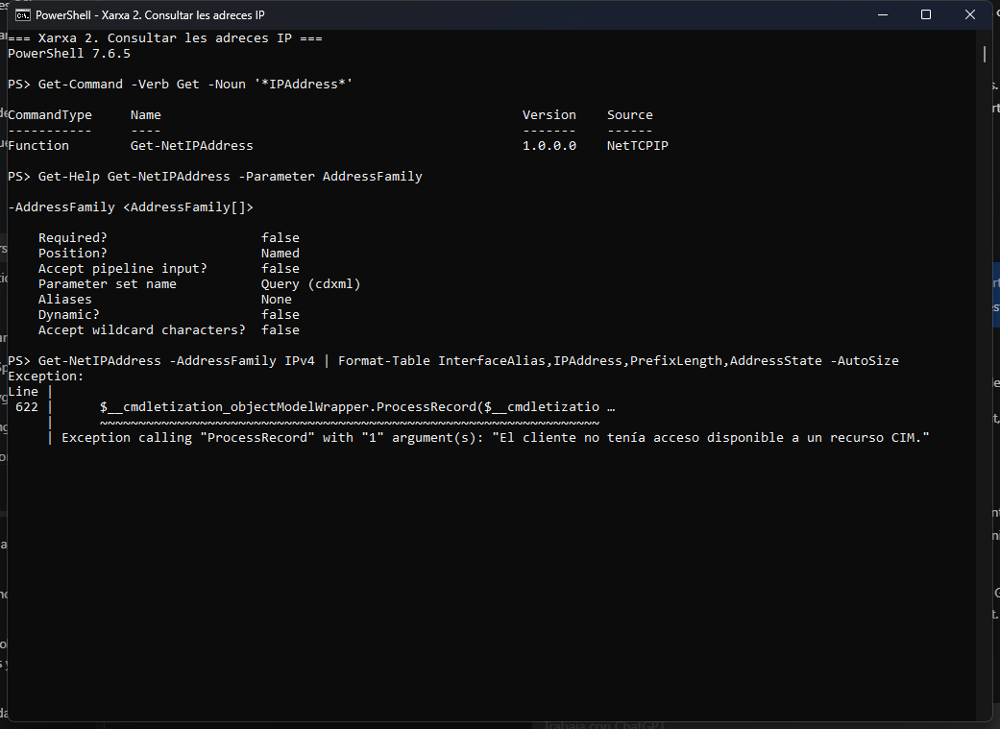
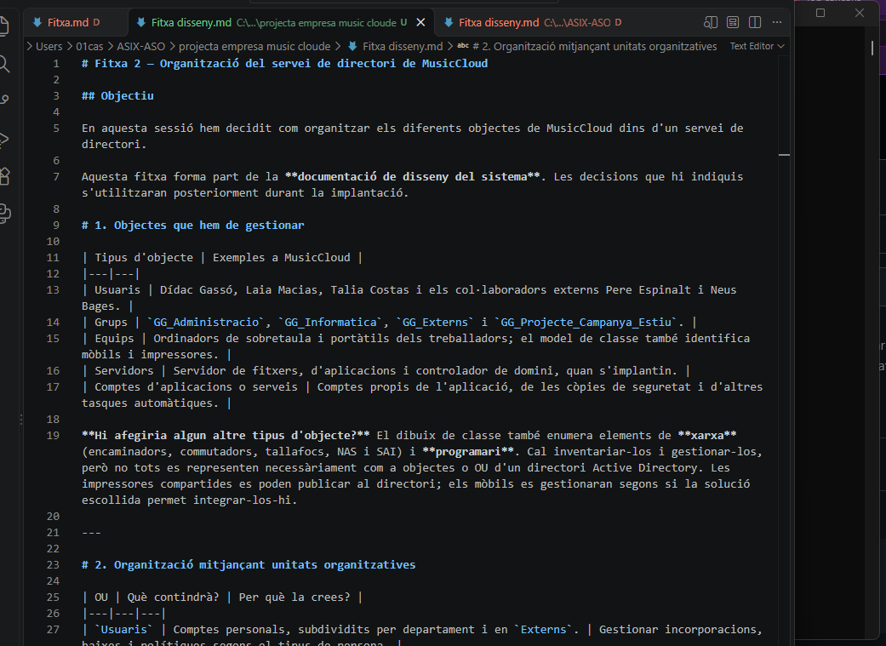
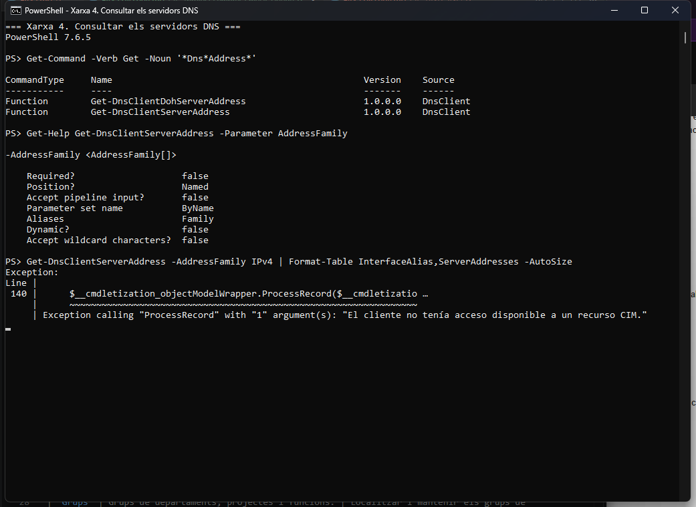
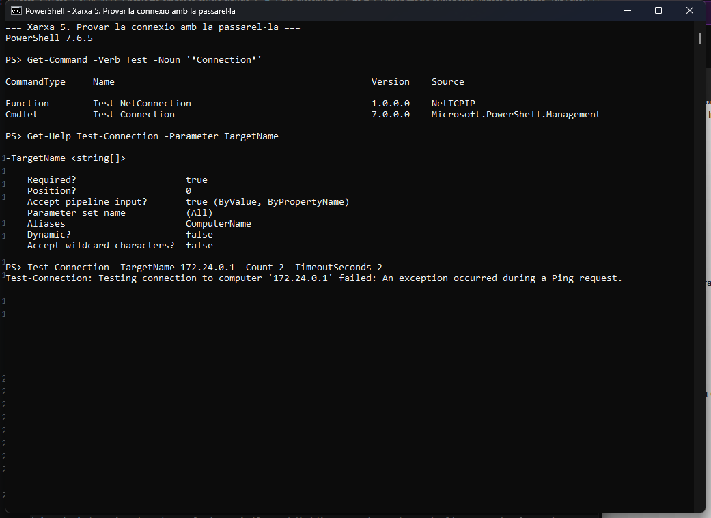
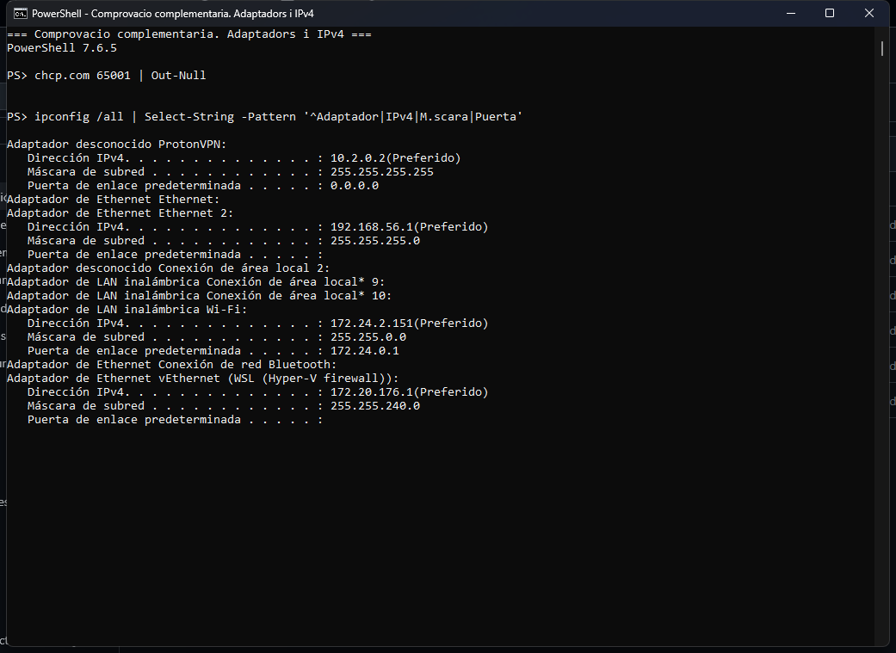
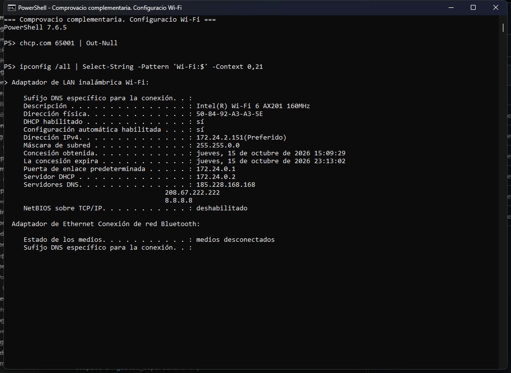
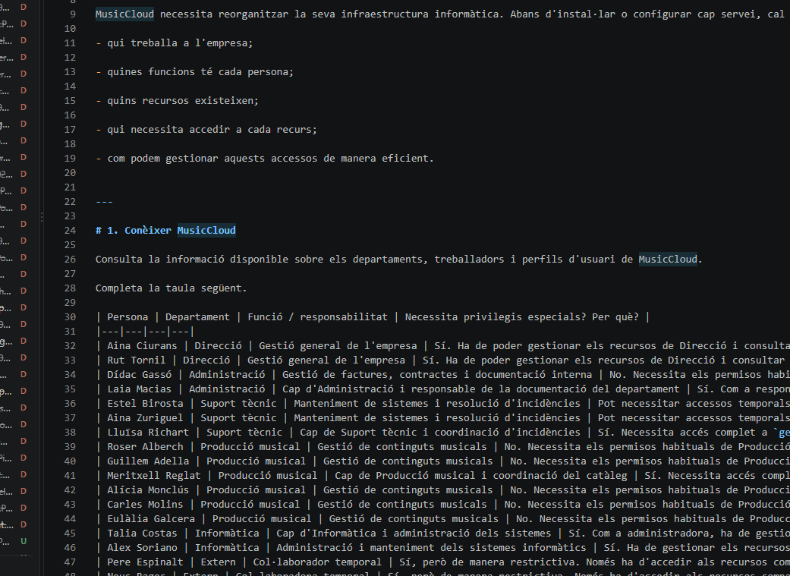

> **Nota:** aquests exercicis serveixen per familiaritzar-se amb PowerShell. He documentat les ordres, les proves i els resultats obtinguts.

# Treballar amb fitxers i carpetes

**Situació:** descobrir les ordres per treballar amb fitxers i carpetes utilitzant `Get-Command` i `Get-Help`, sense buscar respostes a Internet.

He fet les proves amb PowerShell 7.6.5 sobre Windows. Hi incloc les ordres i les sortides textuals de les execucions reals. Només cal afegir captures quan l'enunciat les demani explícitament.

## 1. Buscar ordres

He buscat les ordres que contenen la paraula `Item`:

```powershell
Get-Command *Item*
```

El comodí `*` permet trobar noms amb qualsevol text abans o després d'`Item`. El resultat mostra el nom, el tipus d'ordre, la versió i el mòdul d'origen.

**Sortida obtinguda:**

```text
CommandType     Name                                               Version    Source
-----------     ----                                               -------    ------
Function        Get-DAEntryPointTableItem                          1.0.0.0    DirectAccessClientComponents
Function        Get-TestDriveItem                                  3.4.0      Pester
Function        New-DAEntryPointTableItem                          1.0.0.0    DirectAccessClientComponents
Function        Remove-DAEntryPointTableItem                       1.0.0.0    DirectAccessClientComponents
Function        Rename-DAEntryPointTableItem                       1.0.0.0    DirectAccessClientComponents
Function        Reset-DAEntryPointTableItem                        1.0.0.0    DirectAccessClientComponents
Function        Set-DAEntryPointTableItem                          1.0.0.0    DirectAccessClientComponents
Cmdlet          Clear-Item                                         7.0.0.0    Microsoft.PowerShell.Management
Cmdlet          Clear-ItemProperty                                 7.0.0.0    Microsoft.PowerShell.Management
Cmdlet          Copy-Item                                          7.0.0.0    Microsoft.PowerShell.Management
Cmdlet          Copy-ItemProperty                                  7.0.0.0    Microsoft.PowerShell.Management
Cmdlet          Get-ChildItem                                      7.0.0.0    Microsoft.PowerShell.Management
Cmdlet          Get-Item                                           7.0.0.0    Microsoft.PowerShell.Management
Cmdlet          Get-ItemProperty                                   7.0.0.0    Microsoft.PowerShell.Management
Cmdlet          Get-ItemPropertyValue                              7.0.0.0    Microsoft.PowerShell.Management
Cmdlet          Invoke-Item                                        7.0.0.0    Microsoft.PowerShell.Management
Cmdlet          Move-Item                                          7.0.0.0    Microsoft.PowerShell.Management
Cmdlet          Move-ItemProperty                                  7.0.0.0    Microsoft.PowerShell.Management
Cmdlet          New-Item                                           7.0.0.0    Microsoft.PowerShell.Management
Cmdlet          New-ItemProperty                                   7.0.0.0    Microsoft.PowerShell.Management
Cmdlet          Remove-Item                                        7.0.0.0    Microsoft.PowerShell.Management
Cmdlet          Remove-ItemProperty                                7.0.0.0    Microsoft.PowerShell.Management
Cmdlet          Rename-Item                                        7.0.0.0    Microsoft.PowerShell.Management
Cmdlet          Rename-ItemProperty                                7.0.0.0    Microsoft.PowerShell.Management
Cmdlet          Set-Item                                           7.0.0.0    Microsoft.PowerShell.Management
Cmdlet          Set-ItemProperty                                   7.0.0.0    Microsoft.PowerShell.Management
Application     UevTemplateConfigItemGenerator.exe                 0.0.0.0    C:\Windows\system32\UevTemplateConfigItemGene…
```


Entre els resultats he identificat aquestes ordres:

| Acció | Cmdlet trobat |
|---|---|
| Crear un element | `New-Item` |
| Eliminar un element | `Remove-Item` |
| Canviar el nom d'un element | `Rename-Item` |
| Copiar un element | `Copy-Item` |
| Moure un element | `Move-Item` |

També hi apareixen `Get-Item` i `Get-ChildItem`, que permeten consultar un element i llistar el contingut d'una carpeta. Encara no he executat cap ordre que modifiqui fitxers.

---

## 2. Investigar una ordre

Abans de crear cap element, he consultat:

```powershell
Get-Help New-Item
```

**Sortida obtinguda:**

```text
NAME
    New-Item

SYNTAX
    New-Item [-Path] <string[]> [-ItemType <string>] [-Value <Object>] [-Force] [-Credential <pscredential>] [-WhatIf]
    [-Confirm] [<CommonParameters>]

    New-Item [[-Path] <string[]>] -Name <string> [-ItemType <string>] [-Value <Object>] [-Force] [-Credential
    <pscredential>] [-WhatIf] [-Confirm] [<CommonParameters>]


ALIASES
    ni


REMARKS
    Get-Help cannot find the Help files for this cmdlet on this computer. It is displaying only partial help.
        -- To download and install Help files for the module that includes this cmdlet, use Update-Help.
        -- To view the Help topic for this cmdlet online, type: "Get-Help New-Item -Online" or
           go to https://go.microsoft.com/fwlink/?LinkID=2096592.
```


### Per a què serveix New-Item?

Serveix per crear un element nou. En el sistema de fitxers pot crear un fitxer o una carpeta; els tipus disponibles depenen del proveïdor on es treballa.

### Quina estructura té?

Una de les formes que mostra l'ajuda és:

```powershell
New-Item -Path <ubicació> -Name <nom> -ItemType <tipus>
```

Els textos entre `< >` són marcadors que cal substituir per valors reals.

| Paràmetre | Funció |
|---|---|
| `-Path` | Indica la ubicació on es crearà l'element. |
| `-Name` | Indica el nom del nou element. |
| `-ItemType` | Indica si volem un fitxer, una carpeta o un altre tipus admès. |

### Consulta d'exemples

```powershell
Get-Help New-Item -Examples
```

**Sortida obtinguda:**

```text
NAME
    New-Item

ALIASES
    ni


REMARKS
    Get-Help cannot find the Help files for this cmdlet on this computer. It is displaying only partial help.
        -- To download and install Help files for the module that includes this cmdlet, use Update-Help.
        -- To view the Help topic for this cmdlet online, type: "Get-Help New-Item -Online" or
           go to https://go.microsoft.com/fwlink/?LinkID=2096592.
```


**Resultat real:** aquest equip no té instal·lats els fitxers d'ajuda complets. La primera consulta mostra la sintaxi, però `-Examples` no proporciona exemples. No he utilitzat `-Online` ni `Update-Help`, perquè l'activitat demana investigar sense Internet. Les proves dels apartats següents permeten comprovar el funcionament.

---

## 3. Descobrir un paràmetre

He consultat el paràmetre `-ItemType`:

```powershell
Get-Help New-Item -Parameter ItemType
```

La informació local indica que accepta un text (`string`), que es passa pel nom del paràmetre i que també té l'àlies `Type`. Com que l'ajuda és parcial, no enumera els valors disponibles. He provat `Directory`, el valor suggerit a l'enunciat, per comprovar que crea una carpeta.

He preparat una carpeta de pràctica anomenada `practica-fitxers` dins de l'espai de treball temporal i m'hi he situat amb `Set-Location -LiteralPath $practica`. Des d'allà he executat:

```powershell
New-Item -ItemType Directory -Name Prova
Get-ChildItem
```

**Sortida obtinguda:**

```text
PS> Get-Help New-Item -Parameter ItemType

-ItemType <string>

    Required?                    false
    Position?                    Named
    Accept pipeline input?       true (ByPropertyName)
    Parameter set name           (All)
    Aliases                      Type
    Dynamic?                     false
    Accept wildcard characters?  false
PS> $practica = 'C:\Users\01cas\Documents\Codex\2026-10-15\pots-accedir-al-meu-prjecta-de\work\practica-fitxers'; New-Item -ItemType Directory -Path $practica | Out-Null; Set-Location -LiteralPath $practica

PS> New-Item -ItemType Directory -Name Prova

    Directory: C:\Users\01cas\Documents\Codex\2026-10-15\pots-accedir-al-meu-prjecta-de\work\practica-fitxers

Mode                 LastWriteTime         Length Name
----                 -------------         ------ ----
d----          15/10/2026    16:08                Prova
PS> Get-ChildItem

    Directory: C:\Users\01cas\Documents\Codex\2026-10-15\pots-accedir-al-meu-prjecta-de\work\practica-fitxers

Mode                 LastWriteTime         Length Name
----                 -------------         ------ ----
d----          15/10/2026    16:08                Prova
```


**Resultat:** s'ha creat `Prova`. El llistat la mostra amb el mode `d----`, que indica que és un directori. Si no indico `-Path`, la carpeta es crea a la ubicació actual de PowerShell.

---

## 4. Nou repte: reanomenar, copiar, moure i eliminar

### 4.1. Descobrir l'ordre per canviar el nom

He revisat els resultats de `Get-Command *Item*` de l'apartat 1 i hi he trobat `Rename-Item`. Després he consultat:

```powershell
Get-Help Rename-Item -Examples
```

**Sortida obtinguda:**

```text
NAME
    Rename-Item

ALIASES
    rni
    ren


REMARKS
    Get-Help cannot find the Help files for this cmdlet on this computer. It is displaying only partial help.
        -- To download and install Help files for the module that includes this cmdlet, use Update-Help.
        -- To view the Help topic for this cmdlet online, type: "Get-Help Rename-Item -Online" or
           go to https://go.microsoft.com/fwlink/?LinkID=2097153.
```


L'ajuda local tampoc no inclou els exemples d'aquesta ordre. He consultat també `Get-Help Rename-Item`, que mostra la sintaxi amb `-LiteralPath` i `-NewName`.

Per preparar la resta de proves he utilitzat únicament les eines d'investigació demanades:

```powershell
Get-Help Copy-Item
Get-Help Copy-Item -Parameter Recurse
Get-Help Move-Item
Get-Help Remove-Item
```

La sintaxi mostra els paràmetres de ruta, destinació i recursivitat. He comprovat el seu efecte amb les proves següents, sense buscar respostes a Internet.

### 4.2. Crear una carpeta i un fitxer de prova

La carpeta `Prova` ja s'ha creat a l'apartat 3 amb:

```powershell
New-Item -ItemType Directory -Name Prova
```

Hi he afegit un fitxer per comprovar que la còpia inclou el contingut:

```powershell
New-Item -Path .\Prova -Name nota.txt -ItemType File -Value 'Prova de fitxers amb PowerShell'
```

**Resultat:** s'ha creat `nota.txt`, de 31 bytes, dins de `Prova`.

### 4.3. Canviar-li el nom

```powershell
Rename-Item -LiteralPath .\Prova -NewName ProvaReanomenada
```

**Resultat:** la carpeta passa a dir-se `ProvaReanomenada` i conserva `nota.txt`. Amb `-NewName` indico el nou nom, sense canviar-la d'ubicació.

### 4.4. Copiar-la

```powershell
Copy-Item -LiteralPath .\ProvaReanomenada -Destination .\ProvaCopia -Recurse
Get-ChildItem -Recurse | Format-Table Mode,Name,Directory -AutoSize
```

**Resultat:** hi ha dues carpetes, `ProvaReanomenada` i `ProvaCopia`, cadascuna amb `nota.txt`. `-Recurse` copia també el contingut de la carpeta.

**Sortida obtinguda:**

```text
PS> New-Item -Path .\Prova -Name nota.txt -ItemType File -Value 'Prova de fitxers amb PowerShell'

    Directory: C:\Users\01cas\Documents\Codex\2026-10-15\pots-accedir-al-meu-prjecta-de\work\practica-fitxers\Prova

Mode                 LastWriteTime         Length Name
----                 -------------         ------ ----
-a---          15/10/2026    16:09             31 nota.txt
PS> Rename-Item -LiteralPath .\Prova -NewName ProvaReanomenada

PS> Copy-Item -LiteralPath .\ProvaReanomenada -Destination .\ProvaCopia -Recurse

PS> Get-ChildItem -Recurse | Format-Table Mode,Name,Directory -AutoSize

Mode  Name             Directory
----  ----             ---------
d---- ProvaCopia
d---- ProvaReanomenada
-a--- nota.txt         C:\Users\01cas\Documents\Codex\2026-10-15\pots-accedir-al-meu-prjecta-de\work\practica-fitxers\Prova…
-a--- nota.txt         C:\Users\01cas\Documents\Codex\2026-10-15\pots-accedir-al-meu-prjecta-de\work\practica-fitxers\Prova…
```


### 4.5. Moure-la

```powershell
New-Item -ItemType Directory -Name Desti
Move-Item -LiteralPath .\ProvaCopia -Destination .\Desti
Get-ChildItem .\Desti -Recurse | Format-Table Mode,Name -AutoSize
```

**Resultat:** `ProvaCopia` ara és dins de `Desti` i conserva el fitxer. A diferència de copiar, moure canvia la ubicació de l'element original.

### 4.6. Eliminar-la i comprovar el resultat

Abans d'eliminar res he resolt la ruta absoluta i he comprovat que correspon exactament a la còpia dins de la carpeta de pràctica:

```powershell
$copia = (Resolve-Path -LiteralPath .\Desti\ProvaCopia).Path
if ($copia -ne (Join-Path $PWD.Path 'Desti\ProvaCopia')) {
    throw 'Ruta inesperada'
}
Remove-Item -LiteralPath $copia -Recurse

Test-Path .\Desti\ProvaCopia
Test-Path .\ProvaReanomenada\nota.txt
```

**Resultat:** la primera comprovació retorna `False` perquè la còpia s'ha eliminat, i la segona retorna `True` perquè el fitxer de la carpeta original es conserva. `-Recurse` permet eliminar la carpeta amb el seu contingut.

**Sortida obtinguda:**

```text
PS> New-Item -ItemType Directory -Name Desti

    Directory: C:\Users\01cas\Documents\Codex\2026-10-15\pots-accedir-al-meu-prjecta-de\work\practica-fitxers

Mode                 LastWriteTime         Length Name
----                 -------------         ------ ----
d----          15/10/2026    16:10                Desti
PS> Move-Item -LiteralPath .\ProvaCopia -Destination .\Desti

PS> Get-ChildItem .\Desti -Recurse | Format-Table Mode,Name -AutoSize

Mode  Name
----  ----
d---- ProvaCopia
-a--- nota.txt
PS> $copia = (Resolve-Path -LiteralPath .\Desti\ProvaCopia).Path; if ($copia -ne (Join-Path $PWD.Path 'Desti\ProvaCopia')) { throw 'Ruta inesperada' }

PS> Remove-Item -LiteralPath $copia -Recurse

PS> Test-Path .\Desti\ProvaCopia; Test-Path .\ProvaReanomenada\nota.txt
False
True
```


### 4.7. Ordres descobertes

| Acció | Cmdlet | Paràmetres utilitzats |
|---|---|---|
| Crear una carpeta | `New-Item` | `-ItemType Directory -Name` |
| Canviar-li el nom | `Rename-Item` | `-LiteralPath -NewName` |
| Copiar-la amb el contingut | `Copy-Item` | `-LiteralPath -Destination -Recurse` |
| Moure-la | `Move-Item` | `-LiteralPath -Destination` |
| Eliminar-la amb el contingut | `Remove-Item` | `-LiteralPath -Recurse` |

`Get-Command` i `Get-Help` han servit per investigar. `Get-ChildItem` i `Test-Path` han servit per verificar les proves.

---

# Descobrir ordres de xarxa amb PowerShell

**Situació:** descobrir com consultar la configuració de xarxa d'un equip Windows.

Per a cada tasca documento el cmdlet, la cerca amb `Get-Command`, la consulta amb `Get-Help`, què fa, l'ordre executada i el resultat real. No he consultat Internet per resoldre els exercicis.


## 1. Mostrar els adaptadors de xarxa

**Cmdlet trobat:** `Get-NetAdapter`. Serveix per consultar els adaptadors de xarxa i dades com el nom, la descripció, l'estat i la velocitat d'enllaç.

### Com l'he localitzat

```powershell
Get-Command -Verb Get -Noun '*Adapter'
Get-Help Get-NetAdapter
Get-Help Get-NetAdapter -Examples
```

La cerca ha retornat `Get-NetAdapter`, del mòdul `NetAdapter`, entre altres ordres. Tot i que `Get-Command` el classifica com a `Function` perquè és una ordre generada sobre CIM, és l'ordre de PowerShell adequada per a aquesta tasca. L'ajuda local mostra la sintaxi, però no inclou exemples complets.

### Ordre executada i resultat

```powershell
Get-NetAdapter | Format-Table Name,InterfaceDescription,Status,LinkSpeed -AutoSize
```


**Resultat real:** l'ordre s'ha intentat executar, però la sessió retorna una excepció de CIM:

```text
Exception calling "ProcessRecord" with "1" argument(s):
"El cliente no tenía acceso disponible a un recurso CIM."
```

Per tant, no he obtingut el llistat d'adaptadors. He descobert l'ordre, però aquesta comprovació queda limitada pels permisos de l'entorn d'execució; no és un resultat que indiqui que l'equip no tingui adaptadors.

---


## 2. Consultar les adreces IP configurades

**Cmdlet trobat:** `Get-NetIPAddress`. Consulta les adreces IP de les interfícies i propietats com la longitud del prefix i l'estat de l'adreça.

### Com l'he localitzat

```powershell
Get-Command -Verb Get -Noun '*IPAddress*'
Get-Help Get-NetIPAddress -Parameter AddressFamily
```

La cerca ha retornat `Get-NetIPAddress`, del mòdul `NetTCPIP`. L'ajuda del paràmetre confirma que `-AddressFamily` és opcional i permet especificar la família d'adreces.

### Ordre executada i resultat

```powershell
Get-NetIPAddress -AddressFamily IPv4 |
    Format-Table InterfaceAlias,IPAddress,PrefixLength,AddressState -AutoSize
```

He triat IPv4 per fer el resultat més fàcil de llegir. Sense aquest filtre, l'ordre també permet consultar les adreces IPv6.



**Resultat real:** la sessió retorna `El cliente no tenía acceso disponible a un recurso CIM.` No s'han pogut llegir les IP des d'aquest entorn. Això no significa que l'equip no tingui cap IP configurada.

---


## 3. Consultar la configuració IP completa dels adaptadors

**Cmdlet trobat:** `Get-NetIPConfiguration`. Reuneix informació de les interfícies, les adreces IP, la passarel·la predeterminada i els servidors DNS.

### Com l'he localitzat

```powershell
Get-Command -Verb Get -Noun '*IPConfiguration*'
Get-Help Get-NetIPConfiguration -Parameter Detailed
```

La cerca ha retornat l'ordre del mòdul `NetTCPIP`. `-Detailed` és un commutador que demana més detall.

### Ordre executada i resultat

```powershell
Get-NetIPConfiguration -All -Detailed
```

Amb `-All` demano incloure totes les interfícies que admet aquesta consulta, i amb `-Detailed` n'amplio la informació.



**Resultat real:**

```text
New-CimSession: El cliente no tenía acceso disponible a un recurso CIM.
```

L'ordre falla en crear la sessió CIM i no retorna la configuració IP. Caldrà repetir-la en una sessió amb accés a aquest recurs per obtenir els valors de l'equip.

---


## 4. Consultar els servidors DNS configurats

**Cmdlet trobat:** `Get-DnsClientServerAddress`. Consulta les adreces dels servidors DNS configurats per a cada interfície de xarxa.

### Com l'he localitzat

```powershell
Get-Command -Verb Get -Noun '*Dns*Address*'
Get-Help Get-DnsClientServerAddress -Parameter AddressFamily
```

La cerca ha retornat `Get-DnsClientServerAddress` i `Get-DnsClientDohServerAddress`, del mòdul `DnsClient`. He escollit la primera ordre per consultar els servidors DNS de les interfícies.

### Ordre executada i resultat

```powershell
Get-DnsClientServerAddress -AddressFamily IPv4 |
    Format-Table InterfaceAlias,ServerAddresses -AutoSize
```



**Resultat real:** la consulta torna a fallar amb `El cliente no tenía acceso disponible a un recurso CIM.` No he obtingut cap llistat de DNS amb aquest cmdlet. Aquest error és una limitació d'accés de la sessió, no una prova que falti configuració DNS.

---


## 5. Comprovar la connectivitat amb un altre equip de la xarxa

**Cmdlet trobat:** `Test-Connection`. Envia peticions ICMP Echo, com un ping, a un altre equip i mostra el resultat de les respostes.

### Com l'he localitzat

```powershell
Get-Command -Verb Test -Noun '*Connection*'
Get-Help Test-Connection -Parameter TargetName
Get-Help Test-Connection -Parameter Count
Get-Help Test-Connection -Parameter TimeoutSeconds
```

La cerca ha retornat `Test-Connection` i `Test-NetConnection`. He triat `Test-Connection` per fer la prova ICMP. L'ajuda confirma que `-TargetName` especifica la destinació; `-Count` permet limitar el nombre de peticions i `-TimeoutSeconds` el temps d'espera.

### Destinació i ordre executada

Com que `Get-NetIPConfiguration` falla, he llegit la passarel·la amb `ipconfig`, una ordre de Windows executada des de PowerShell. L'he utilitzat només per obtenir una destinació real, no per descobrir els cmdlets. La passarel·la de la interfície Wi-Fi és `172.24.0.1`, un altre equip de la xarxa.

```powershell
Test-Connection -TargetName 172.24.0.1 -Count 2 -TimeoutSeconds 2
```



**Resultat real:**

```text
Test-Connection: Testing connection to computer '172.24.0.1' failed:
An exception occurred during a Ping request.
```

La prova s'ha interromput amb una excepció; no ha retornat dues respostes de ping ni permet calcular latències o pèrdues. Tampoc no permet concloure que la passarel·la estigui apagada o que no hi hagi Internet: no s'ha pogut completar la petició ICMP des d'aquesta sessió.

### Ordres de xarxa descobertes

| Tasca | Ordre |
|---|---|
| Mostrar adaptadors | `Get-NetAdapter` |
| Consultar IP | `Get-NetIPAddress` |
| Consultar la configuració IP completa | `Get-NetIPConfiguration` |
| Consultar DNS | `Get-DnsClientServerAddress` |
| Provar connectivitat ICMP | `Test-Connection` |

Les ordres s'han descobert amb `Get-Command` i `Get-Help`. He conservat els errors reals de les execucions perquè els resultats es puguin comprovar i repetir.

---


## 6. Comprovació complementària amb ipconfig

Per obtenir dades reals malgrat els errors de CIM, he executat `ipconfig /all` des de PowerShell. És una ordre externa de Windows, **no un cmdlet**; aquesta comprovació complementa les consultes anteriors. Les ordres dels apartats 1 a 5 s'han investigat amb `Get-Command` i `Get-Help`.

### Adaptadors i adreces IPv4

Per fer llegible la captura he filtrat la sortida, conservant els noms d'adaptador, les IPv4, les màscares i les passarel·les:

```powershell
ipconfig /all | Select-String -Pattern '^Adaptador|IPv4|M.scara|Puerta'
```



Hi apareixen adaptadors físics i virtuals: Wi-Fi, Ethernet, Ethernet 2, ProtonVPN, dues interfícies Wi-Fi Direct, una interfície TAP, Bluetooth i vEthernet de WSL.

| Interfície | IPv4 | Màscara | Passarel·la mostrada |
|---|---|---|---|
| Wi-Fi | `172.24.2.151` | `255.255.0.0` | `172.24.0.1` |
| Ethernet 2 (VirtualBox) | `192.168.56.1` | `255.255.255.0` | Sense valor |
| ProtonVPN | `10.2.0.2` | `255.255.255.255` | `0.0.0.0` (valor mostrat per la VPN) |
| vEthernet de WSL | `172.20.176.1` | `255.255.240.0` | Sense valor |

### Configuració detallada de la Wi-Fi

```powershell
ipconfig /all | Select-String -Pattern 'Wi-Fi:$' -Context 0,21
```



La interfície Wi-Fi utilitza l'adaptador Intel(R) Wi-Fi 6 AX201 160MHz. Té DHCP activat i el servidor DHCP és `172.24.0.2`. La seva passarel·la és `172.24.0.1`, la destinació escollida per a la prova de connectivitat.

### Servidors DNS

```powershell
ipconfig /all | Select-String -Pattern 'Servidores DNS' -Context 0,2
```



| Interfície | Servidors DNS configurats |
|---|---|
| ProtonVPN | `10.2.0.1` |
| Wi-Fi | `185.228.168.168`, `208.67.222.222` i `8.8.8.8` |

Aquests són els valors configurats que mostra `ipconfig`; no he fet una prova de resolució DNS ni puc afirmar, només amb aquest llistat, quin servidor s'utilitza en cada consulta.

**Estat de les proves:** les operacions amb fitxers i carpetes han funcionat. La informació de xarxa s'ha pogut llegir amb `ipconfig`, però cal repetir els quatre cmdlets de consulta en una sessió amb accés a CIM. La prova ICMP també queda pendent de repetir fora de l'entorn restringit.
